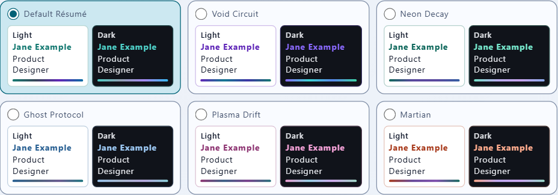

# PDF Designer ✨

**Design in HTML. Print what you see.**

A local résumé studio that keeps your career data yours.

Design documents in HTML and export them locally as PDFs. The Design Hub includes a résumé import wizard, light ATS and dark branded exports, collages, presentation starters, and document checks. Start with a fictional example or bring your own résumé. Career data stays in your local workspace.

- [Get started](docs/GETTING-STARTED.md) to set up the free toolkit and open the Design Hub.
- [Browse the official docs](docs/README.md) for exports, templates, QA, and packaging.

## Wizard palette preview

<picture>
  <source media="(prefers-color-scheme: dark)" srcset="assets/public/hub/wizard-palettes-dark.png">
  <source media="(prefers-color-scheme: light)" srcset="assets/public/hub/wizard-palettes-light.png">
  
</picture>

## Personal workspaces

The wizard saves your editable résumé, render profile and vault locally. See the [workspace guide](docs/STORAGE.md) for generated PDF locations, the [profile guide](profiles/README.md) for presentation preferences and the [examples catalog](examples/README.md) for fictional starters. The repository contains the MIT-licensed public toolkit and its documented examples. [Public and local files](docs/PUBLIC-LOCAL-SPLIT.md)

---

If you enjoyed this repo: ✨

[Star this repo](https://github.com/jenninexus/pdf-designer) · [Links](https://jenninexus.com/links) · [Patreon](https://www.patreon.com/c/JenniNexus) · [PayPal](https://paypal.me/jenninexus)

[Product walkthrough](https://jenninexus.com/blog/pdf-designer) · [Windows app privacy notice](https://jenninexus.com/pdf-designer-privacy)

Optional tip **$5**.

Made with 💚 by [Jenni](https://github.com/jenninexus) at [Monofinity Studio](https://github.com/monofinitystudio)

