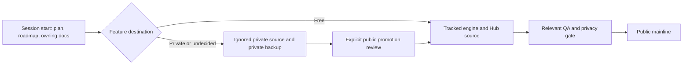

# Development flow — local Hub to public product

The Design Hub is the local development surface. Work in the owning checkout and record the slice in the active checklist named by `Plans/README.md`; use `ROADMAP.md` for the durable backlog. Choose each feature's destination before implementation.

1. **Incubate locally.** Personal data stays in ignored roots. Future paid-only source belongs under ignored `private/premium/` (or an equivalently verified private location), with private ownership and backup. Ignoring a path does not protect a file already tracked or in public history. No premium loader or separate package is implemented by this policy.
2. **Review the candidate.** Decide explicitly whether a feature is public, paid-only, or undecided. Inspect the exact staged diff and history for personal information, secrets and paid intellectual property; use the existing `scripts/check-public-push.py` gate and normal hooks. Do not copy paid code into tracked paths by accident.
3. **Promote deliberately.** Only a feature explicitly selected for public release moves into tracked source. Preserve the implementation and its dependencies; update the owning docs and roadmap. Promotion is a product decision, not an automatic consequence of local development.
4. **Verify and land.** Run the relevant source and artifact QA, the privacy gate, and normal hooks; verify the intended public mainline contains the change. Existing MIT engine and basic helper code already published remains available under its existing license.
5. **Distribute separately.** A public source push does not release an installer, store listing, account service, or subscription. Each has its own security, packaging, signing, fulfilment and release checks.

The proposed tiers and optional identity boundary are in [PRODUCT.md](PRODUCT.md). The exact active execution is in `Plans/README.md` (local only); distribution evidence belongs with the owning channel records.

Before implementing paid features, deliver the private package/loader, backup coverage, entitlement boundary and public-package exclusion checks as a separate accepted slice. `private/premium/` is ignored today but is **not** included automatically in `scripts/private-sync.py`; arrange and verify its private backup before putting valuable source there. A browser-only feature flag or hidden menu does not keep tracked source private. No paid runtime is connected to the current Hub.

## What the theme adapter does

An adapter translates a shared design into the format an app understands. The private theme kits are development inputs; this app runs from its own checked-in CSS.

| Input / step | Responsibility |
|---|---|
| `www-theme-kit/profiles/pdf-designer.json` | The single responsive profile, including the named `lg` desktop-navigation switch at 992px. |
| `syna-theme-kit/adapters/pdf-designer.json` | Selects Aesyna colors, glow, motion and icons for the static Hub. |
| `syna-theme-kit/scripts/sync-pdf-designer.mjs` | Validates the responsive reference and generates the app's visual-token CSS. |
| `src/pdf_tool/static/hub-aesyna.css` | The generated adapter consumed by this Hub alongside its app CSS. It ships with the free app. |

Other projects can have their own adapters to the same design tokens. React/Dockview projects can use Syna's components; this Python/HTML Hub uses generated CSS and does not need React or either private kit at runtime. Change shared visual values in the owning kit, regenerate, inspect the exact diff, and verify the consumer before publishing it.
